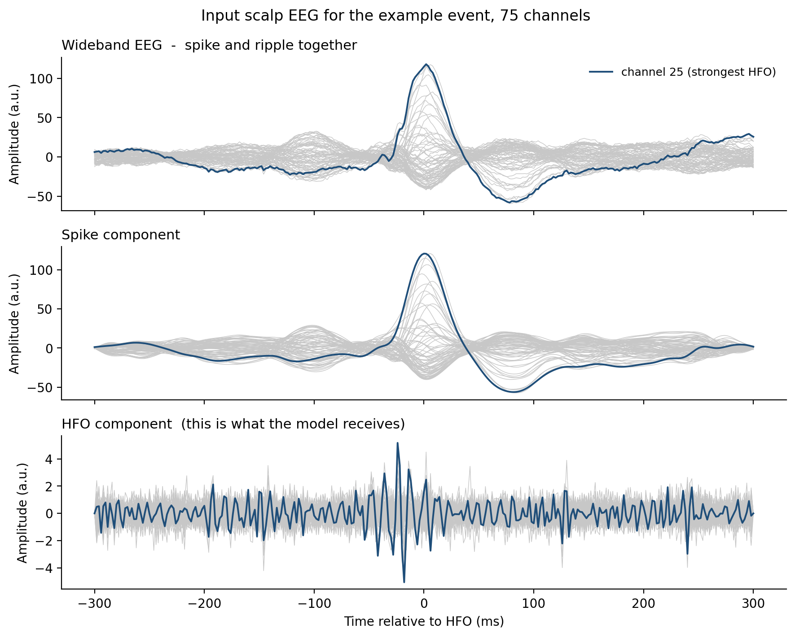
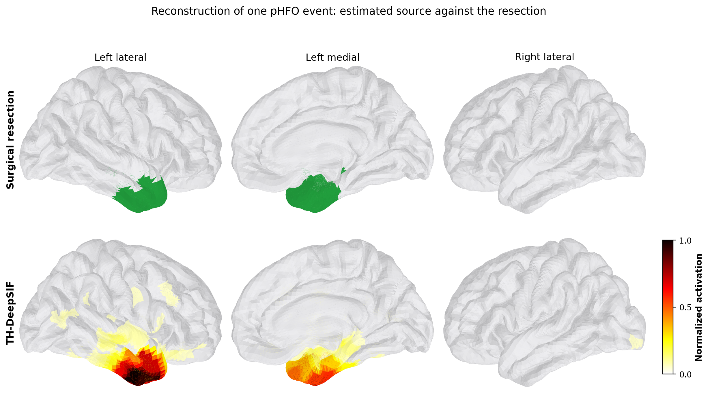
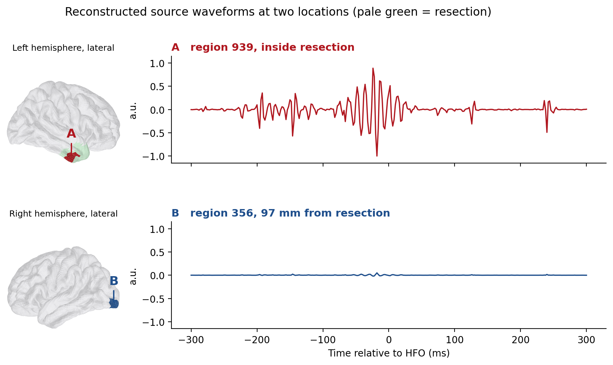

# example_data/

One de-identified pathological HFO (spike-coupled ripple) event, provided so the
clinical pipeline can be run end to end without access to the full cohort.

| File | Contents |
|---|---|
| `patient1/data_75.mat` | One 75-channel scalp EEG epoch, 301 samples at 500 Hz, in `sigEpochSpike_p` |
| `patient1/projected_resection_to_fs_cortex.mat` | The surgical resection projected onto the 994-region parcellation (`resection_region`), used as ground truth |
| `evaluate_example.py` | Scores the reconstruction against the resection |

The event is from a seizure-free patient (ILAE Class I-II) and was chosen because it
localizes cleanly, so a correct installation gives an unambiguous result. Only the
arrays the pipeline reads are included; the files were rewritten from scratch and
carry no acquisition metadata.

**This is not the full clinical dataset.** Results from this single event will not
reproduce the published figures, which aggregate 70 events across 20 patients.

## Running it

With the trained weights in place (see `model_weights/README.md`):

```bash
python eval_real.py \
    --patient_id 1 --patient_root example_data \
    --model_id 44 --arch EnhancedEEGToBrainRegionTransformer --num_layer 6 \
    --num_electrode 75 --spike_type p \
    --highpass_eeg 80 --suppress_distant_hfo 1 \
    --output_folder example_out

python example_data/evaluate_example.py \
    --pred_dir model_weights/44_the_model/example_out
```

## Expected output

```
resection covers 21 of 994 cortical regions

event  n_active  LE(mm)   sens   prec   spec   F1     GM
1      14        2.23     0.619  0.929  1.000  0.743  0.787

localization error: 2.23 mm
```

These are the six metrics reported in Figures 4-5, computed by
`misc_scripts/metrics.py` exactly as in the paper. Thirteen of the fourteen active
regions fall inside the 21-region resection (precision 13/14, sensitivity 13/21).

Small differences across platforms and library versions are expected. A few
millimetres indicates a correct setup; tens of millimetres indicates something is
wrong, usually the wrong checkpoint or a lead field that does not match the montage.

## What the result looks like

### 1. Input EEG



The recorded event, all 75 channels, with the channel carrying the strongest ripple
highlighted. The wideband trace contains both components; the middle panel isolates
the interictal spike and the lower panel the ripple. The pipeline band-passes the
input to the ripple band before it reaches the model, so the lower panel is what
TH-DeepSIF actually sees -- the spike is used to identify the event, not to
reconstruct it.

### 2. Reconstruction on the cortex



Cortical surface with the surgical resection (top, green) and the TH-DeepSIF estimate
(bottom, normalized activation). The estimate peaks in the left temporal lobe inside
the resection, with only faint low-amplitude activity elsewhere and none in the
contralateral hemisphere. Fourteen of the 994 regions exceed the Otsu threshold,
93% of them inside the resection.

### 3. Source waveforms



Reconstructed activity at two locations, on a shared scale, each shown with its
position on the cortex. **A** lies inside the resection and carries a clear ripple
burst around the event. **B** lies 97 mm away in the contralateral hemisphere and is
essentially flat -- about 19x smaller at the peak. Because the model input is
band-passed to the ripple band, the reconstruction contains ripple-band activity only;
no spike waveform is reconstructed.
